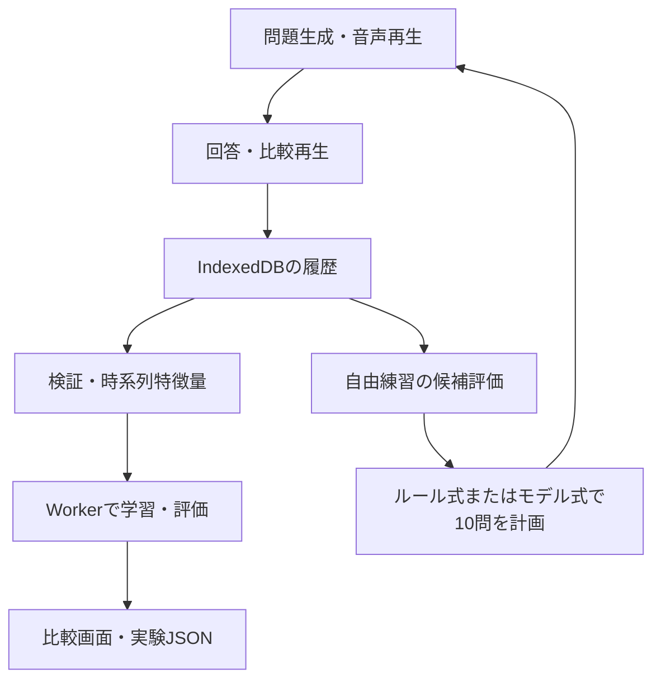

# 構成とデータの流れ

## 責務の対応

| コード | 責務 |
|---|---|
| `app.js`, `samples.js`, `guitar.js` | 音声と構成音、楽器別の配置・再生 |
| `practice.js`, `practice-model.js` | UI、採点、回答記録、バックアップの検証 |
| `progression.js`, `curriculum.js` | 進行候補・種類の並び調整、ステップ解放 |
| `history-store.js`, `reference-policy.js` | IndexedDB、試聴許可と前後の利用回数 |
| `transfer-analysis.js`, `related-pooling.js` | 部分成績、隣接ペア、関連履歴の有界な借用 |
| `confusion-evidence.js` | 正解→誤答の方向を保った取り違え集計 |
| `prediction-model.js` | データ分割、特徴量、3種の学習器、比較指標 |
| `prediction-worker.js`, `prediction-ui.js` | UIを止めずに評価、結果表示・書き出し |
| `adaptive-selection.js`, `adaptive-worker.js` | セッション開始時の履歴から候補評価・出題計画 |
| `scripts/` | 同じアプリコードを読み込むCLI、デモ生成、ローカル配信 |

## 保持するデータ

回答は `userId / sessionId / id`、問題作成・回答時刻、正解と選択した回答、調・楽器・形式・実音の配置、出題方式などを含みます。試聴許可と回答前後の試聴回数は別々です。許可不明の旧履歴は推測で補いません。

適応出題では、要求した方式と実際の方式、切替理由、履歴締切、種、候補数、出題理由、モデル版、予測ベクトルを保持。モデル本体と学習に使ったIDは練習回ごとに保存し、履歴JSONに含めます。問題の予測に、その問題の回答・反応時間・再生回数は使いません。

## 2つの時間の扱い

**予測実験**：学習回→未来の評価回へ分割。モデルは固定ですが、すでに提出された評価回答は次問の過去特徴量に反映します。固定履歴での一括予測とは異なります。

**自由練習**：開始時点で提出済みの履歴から10問を計画。モデルと履歴特徴量はその回の開始時点で固定し、途中の回答で計画を変えません。回答後に示す確率は練習開始時の予測です。

## 故障・不足への対応

履歴不足または学習失敗はルール式へ切替。Worker開始失敗や30秒超過では範囲全体の出題へ戻します。保存に失敗した場合は画面に通知し、ページを閉じる前のJSON保存を案内します。ブラウザのデータ削除に対するサーバーバックアップはありません。
